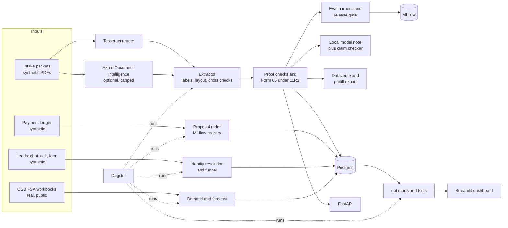
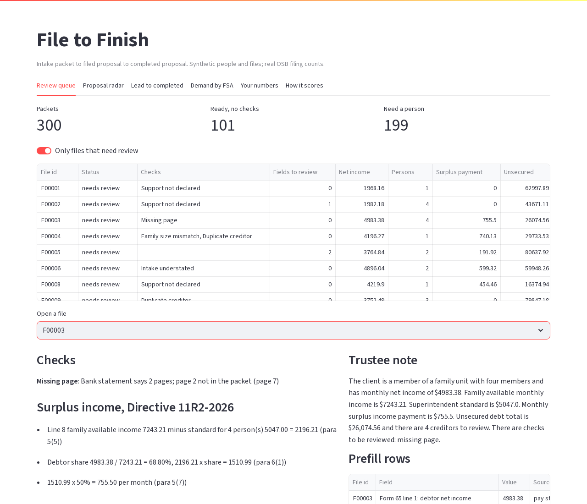
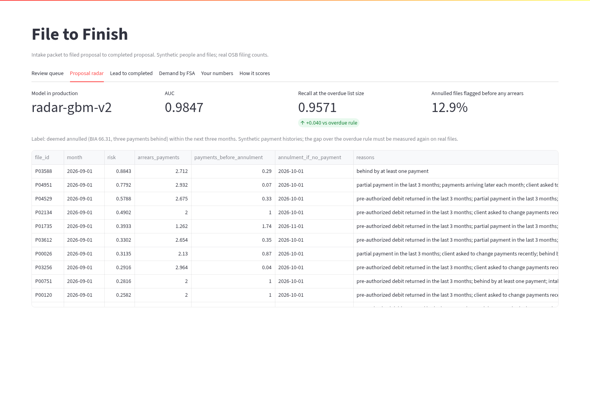
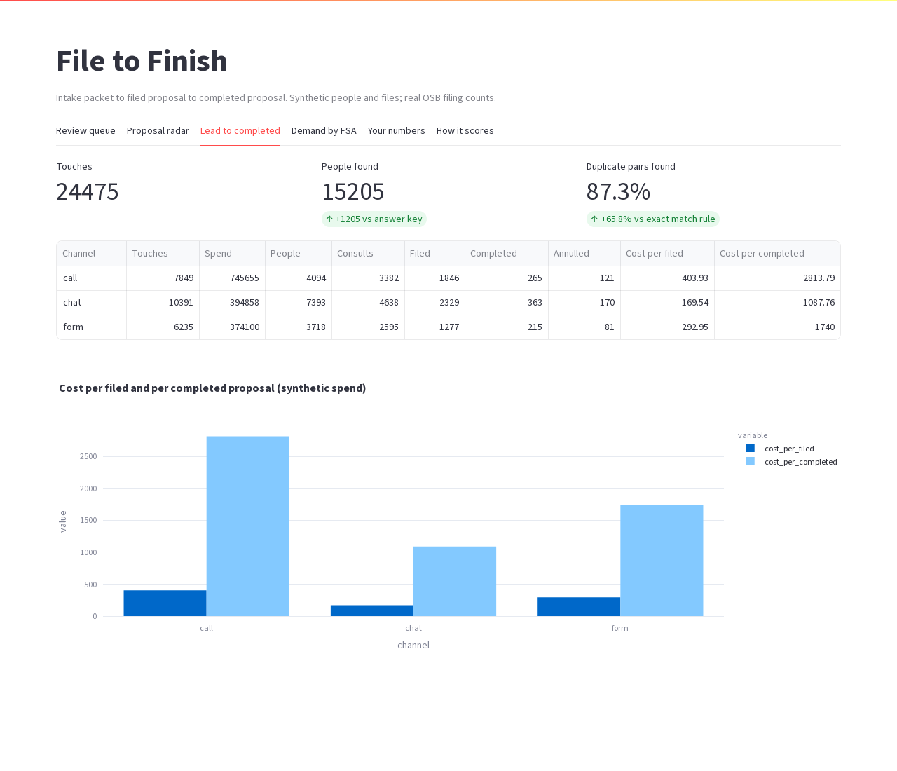
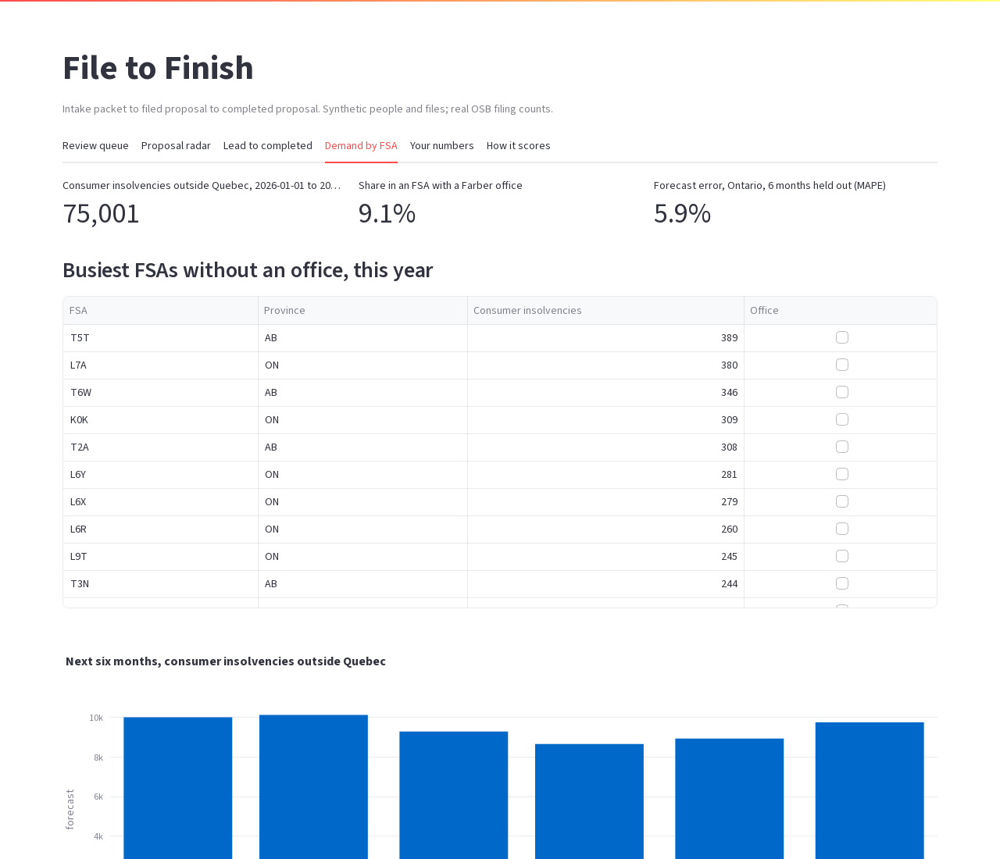
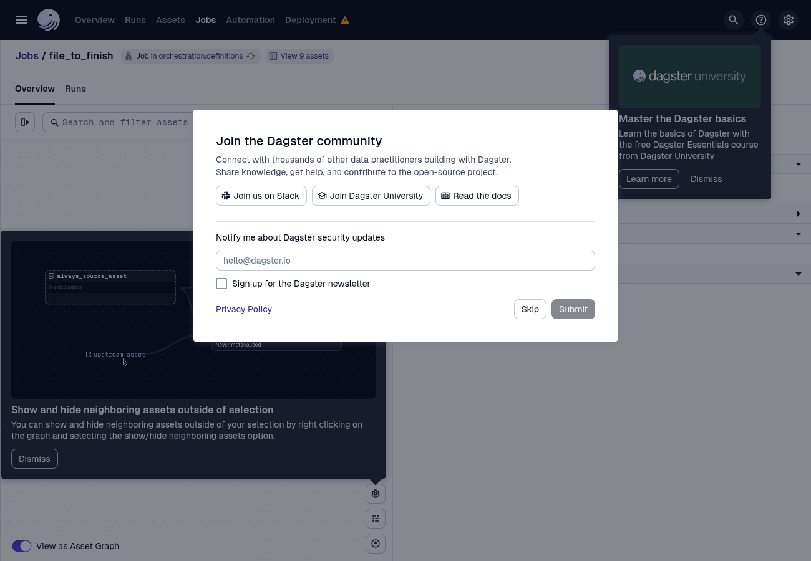

# File to Finish

A working prototype for a Licensed Insolvency Trustee. It takes a client's intake packet, checks it, works out the surplus income payment, and follows the file from the first lead to a completed proposal.

All people, files and leads here are synthetic and marked as such on every page. The filing counts by postal area are real public data from the Office of the Superintendent of Bankruptcy (OSB).

Built by Manish Reddy as a Data Engineer prototype. Contact: manishreddyr998@gmail.com

## What it does

1. **Reads the packet.** Intake worksheet, pay stubs, bank statement, child benefit statement, credit report and collector letters, as clean PDFs, scans, faxes or phone photos.
2. **Checks the proof.** Directive 11R2 asks for proof of income. Ten checks look for things like income the intake leaves out, payroll from an employer with no stub, an old stub, a missing bank page, a family size that does not match, a collector letter for a debt already on the bureau, and support payments nobody declared.
3. **Works out Form 65.** Lines 1 to 15 under Directive 11R2-2026, with each step written out and the 2026 standards.
4. **Writes a short note for the trustee.** A small local model writes it. A claim checker removes any sentence with a number, date or loaded word that the verified figures do not back.
5. **Ranks proposals at risk.** A monthly score for "deemed annulled within three months" (BIA 66.31, three payments behind), compared with the plain overdue rule.
6. **Counts people, not leads.** Chat, call and form touches are resolved to people, then followed to filed and completed files, with cost per completed file by channel.
7. **Shows demand.** Real OSB counts by FSA, a six month forecast, and the busiest areas with no office.
8. **Exports.** Prefill rows for case software and a Dataverse ready export with a source page for every field.

The page reader is swappable. Tesseract (local) and Azure AI Document Intelligence sit behind the same interface, and the same scoring harness and release gate decide between them.

## Architecture



## Run it

You need Docker. The local model weights (about 1.1 GB) download once into `models/`.

```bash
docker compose up --build
```

That starts Postgres and the local model, runs the full Dagster job once, then serves:

| Service | URL |
|---|---|
| Dashboard | http://localhost:8701 |
| API docs | http://localhost:8200/docs |
| Dagster | http://localhost:3200 |
| MLflow | http://localhost:5200 |

Other commands:

```bash
make test      # unit tests in the container
make gate      # extraction gate with the negative control
make small     # 24 packet run
make dbt       # load Postgres and run dbt build with tests
```

Azure is optional. Copy `.env.example` to `.env`, set `AZURE_DI_KEY`, and the comparison step runs on a held out set of 22 scanned, faxed and phone packets (146 pages). Every call is cached under `data/`, and a page counter stops at 150 pages a run and 400 a month, under the free tier's 500. Without a key the step is skipped.

## Results

All numbers come from the files in `results/`, produced by the runs described here. Packets: 300 (40% digital, 30% scan, 15% fax, 15% phone), 11,158 scored fields, 224 planted problems.

### Reading and checking packets (300 packets)

| Extractor | Field accuracy | Wrong but auto accepted | Fields sent to a person | Surplus payment exact | Files wrong and not flagged | Planted problems caught | False alarms on 125 clean files | Gate |
|---|---|---|---|---|---|---|---|---|
| labels-v1 (production baseline) | 97.06% | 4 | 1.81% | 99.67% | 0 | 224 of 224 | 0 | baseline |
| layout-v2 (candidate) | **99.01%** | 1 | 1.50% | 99.67% | 0 | 224 of 224 | 0 | promote |
| layout-v2-fastocr (negative control) | 94.83% | 8 | 3.69% | 94.33% | 3 | 212 of 224 | 10 | block |

layout-v2 by capture: digital 100%, scan 99.4%, phone 99.2%, fax 96.1%. Median 9.4 seconds a packet on CPU.

### Tesseract vs Azure Document Intelligence (same 22 held out packets, 146 pages)

| Reader | Field accuracy | Wrong but auto accepted | Fields sent to a person | Surplus payment exact | Problems caught | Median seconds a packet | Gate |
|---|---|---|---|---|---|---|---|
| Tesseract + layout-v2 | 99.64% | 0 | 0.51% | 100% | 19 of 19 | 11.8 | production |
| Azure prebuilt-read + layout-v2 | 98.69% | 0 | 2.47% | 100% | 18 of 19 | 60.8 | block |

Azure read the text very cleanly, but on this set the local reader scored higher and the gate kept it. The free tier only analyses two pages of each document, so pages go one per call; that, plus free tier throttling, explains the speed. A paid tier and batching would change the time, not the accuracy. Azure pages used this month: 292 of 500.

### Trustee notes (300 files)

| Note source | Notes with a sentence removed | Claims removed | Unsupported claims left in final notes |
|---|---|---|---|
| Local model (Qwen2.5 1.5B, Ollama) | 82 | 92 | 0 |
| Stress test that always adds false claims | 300 | 1,200 | 0 |

Median 6.2 seconds a note on CPU.

### Proposal radar (5,000 synthetic proposals, test split by proposal)

| Version | AUC | Recall with the same call list as the overdue rule | Overdue rule recall | Annulled files flagged before any missed payment | Gate |
|---|---|---|---|---|---|
| radar-logit-v1 (production) | 0.972 | 93.1% | 91.8% | 5.0% | baseline |
| radar-gbm-v2 (candidate) | 0.985 | 95.7% | 91.8% | 12.9% | promote |
| radar-intake-only (negative control) | 0.687 | 19.1% | 91.8% | 5.9% | block |

The overdue rule is a strong baseline. The gain is real but small, and it depends on early signs (late, short or bounced payments) that the simulation builds in. It must be measured again on real payment history before anyone relies on it.

### Leads to people (14,000 synthetic people, 24,475 touches)

| Method | Pair precision | Pair recall | People found (true 14,000) |
|---|---|---|---|
| Exact email or phone | 93.0% | 21.5% | 21,506 |
| Resolver (normalised keys, name check on shared phones) | 98.9% | 87.3% | 15,205 |

### Demand (real OSB data, Jan 2022 to Aug 2026)

* 727 of 727 province sheets reconcile to their own totals.
* Jan to Aug 2026, outside Quebec: 75,001 consumer insolvencies, 60,420 of them proposals (80.6%).
* 9.1% of those filings sit in an FSA that holds a Farber office (73 office FSAs).
* Six months held out: seasonal trend forecast MAPE 4.6% (Canada outside Quebec) and 6.0% (Ontario), vs 6.4% and 8.5% for same month last year. At FSA level the plain seasonal forecast is better (WAPE 38.7% vs 40.3%), so it is used there.
* Busiest FSAs with no office this year: T5T Edmonton 389, L7A Brampton 380, T6W Edmonton 346, K0K Ontario 309, T2A Calgary 308.

### Warehouse

dbt build: 9 staging views, 7 marts, 22 tests, all passing. Tests include the 11R2 payment rule, the 2026 standards by family size, and BIA 66.31 on every annulled proposal.

## Screenshots







## Data sources

| Source | Use | Link |
|---|---|---|
| OSB monthly insolvency statistics by FSA (Open Government Licence) | demand, forecast | https://open.canada.ca/data/en/dataset/34e547e9-8e2f-472c-829b-c3c9d2396555 |
| Directive 11R2-2026, Surplus Income | Form 65 rules, 2026 standards | https://ised-isde.canada.ca/site/office-superintendent-bankruptcy/en/directive-no-11r2-2026-surplus-income |
| BIA section 66.31, deemed annulment | radar label | https://laws-lois.justice.gc.ca/eng/acts/b-3/page-14.html |
| BIA section 66.18, deemed acceptance | proposal clock | https://laws-lois.justice.gc.ca/eng/acts/B-3/section-66.18.html |
| Directive 1R8, counselling | counselling windows | https://www.ised-isde.canada.ca/site/office-superintendent-bankruptcy/en/directive-no-1r8-counselling-insolvency-matters |
| Farber office locations | office FSAs | https://www.farber.ca/locations/ |

Synthetic data: packets, payment ledger, leads and channel cost are generated in `src/filepipe/synth` and `src/filepipe/leads`. Lender and employer names are made up.

## Honest limits

* Synthetic packets follow layouts I designed. Real packets will be messier, and accuracy has to be measured again on a sample of real files.
* The radar's edge over the overdue rule comes from patterns built into the simulation. Treat it as a method, not a result.
* Channel spend is invented. Cost per completed file shows the method only.
* The Azure comparison covers 22 packets because of the free tier page cap.
* The claim checker matches numbers and a list of words. It does not judge tone or meaning beyond that.
* This is not legal advice. A trustee reviews every file.

## Repo map

```
src/filepipe/      rules, synth, ocr, extract, verify, evaluate, gate, narrate, claims, radar, leads, demand, load, api, azure_di, export_dataverse
dbt/               staging, marts, tests
orchestration/     Dagster assets and jobs
dashboard/         Streamlit app
configs/           release gates, office FSAs
tests/             pytest
```
